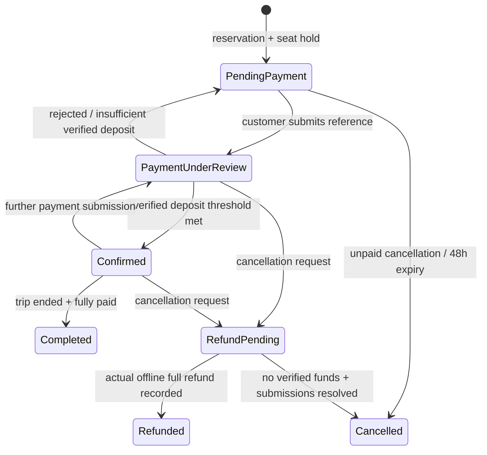

# Architecture and invariants

`src/app` contains server-rendered public pages, protected account/admin pages, and Node.js route handlers. `src/components` contains the interactive search, checkout, dashboards, and forms. `src/lib` contains pricing, booking transitions, authorization, administration, notifications, reporting, and database services. Browser components do not import server database modules.

## Database

Versioned SQL migrations create roles/users/profiles/sessions, destinations, packages/images/pricing, itinerary days/activities, departures, bookings/travelers, submissions and verified payment ledgers, promotions/package eligibility/usage, inquiries/quotations, reviews, notifications/outbox, content, business settings, uploaded images, rate limits, and audit logs. Foreign keys, checks, indexes, unique references, and timestamps enforce core constraints.

MariaDB/MySQL `datetime(3)` columns store UTC instants. Connections explicitly set UTC, use READ COMMITTED isolation, and serialize timestamps back as ISO 8601 UTC. Departure inputs and reports use Asia/Manila. Money uses integer **centavos** in BIGINT columns; no client total is trusted. Fixed discounts are centavos, percent discounts are integers, and deposits round up to the next centavo. Seasonal adjustments apply to adult and child prices.

The mysql2 pool pins each InnoDB transaction to one connection until COMMIT/ROLLBACK. Queries use native prepared statements; numbered application bindings become positional driver parameters. Application inserts generate UUIDs and read them back on the same connection, without relying on a database RETURNING extension. A reservation locks the departure row, computes current pricing/eligibility, increments seats with a capacity/deadline guard, atomically claims promotion usage, inserts travelers, snapshots the original itinerary/prices/policies, and queues its notification in one transaction. Failure rolls back every write. `reserved <= capacity` is a database check.

JSON documents store snapshots/settings and are parsed explicitly on MariaDB, whose JSON storage is text-based. Related itinerary activities, quotations, and promotion eligibility are loaded with ordered queries and joined in application code. Monthly reports group receipts using UTC+08:00 date arithmetic, without requiring the server's optional named-timezone tables.

Published packages require complete sequential itinerary days. A departure with historical reservations cannot change its package or departure time. Capacity cannot be reduced below reserved seats. Price, content, and itinerary changes cannot mutate stored booking snapshots.

## Booking state

Pending Review is supported as an additional pre-payment state. Refunded is a ledger record of an actual offline refund, not a transfer performed by this system. Cancellation with funds or unresolved payment references retains capacity until staff resolves it. A seats-released flag makes release idempotent. Successful verification is unique by submission ID; repeated reviews cannot create another receipt. Refunds lock the booking, so duplicate refund attempts fail.

## Access and APIs

- `POST /api/auth/register|login|logout`: customer registration and opaque database sessions.
- `GET /api/packages`, `/api/departures`, `/api/packages/itinerary?package=...`: public catalog.
- `POST /api/quote`, `/api/bookings`: server quote/reservation.
- `GET /api/bookings/:reference`: account ownership, private guest cookie, or staff required.
- `POST /api/bookings/lookup`: reference + email + secret key establish a guest access cookie.
- `POST /api/bookings/:reference/payment|cancel|review`: protected booking operations.
- `GET /api/bookings/:reference/voucher`: protected confirmed/completed PDF.
- `/api/profile`, `/api/notifications`, `/api/inquiries`: customer functions.
- `/api/admin/:section`: staff-only management. Business settings and staff creation require SUPER_ADMIN.
- `POST /api/assets`, `GET /api/assets/:id`: staff image upload and public immutable marketing imagery.

All state-changing JSON routes enforce exact Origin against APP_URL, request limits, validation, and database rate limits. Role and ownership checks occur server-side on every operation. User-controlled values enter parameterized SQL; content is escaped by React. CSV export prefixes formula-capable cells. Uploads reject SVG, unrecognized signatures, and files above 2 MB. Private booking and accounting JSON responses use no-store headers.

## Operational boundaries

The application records manual receipts and offline refunds. It does not move money. No payment-provider success redirect can confirm a booking. The disabled card-provider interface describes the required raw-body signature validation and event deduplication for future integration. Resend email uses a transactional outbox with provider acceptance recorded separately from in-app notification creation.

Run MariaDB/MySQL migrations once as a release step. They hold a database advisory lock, apply retry-safe CREATE statements, and record checksums after success. DDL commits implicitly on these engines. Runtime verifies the latest schema version and refuses database operations when migrations are missing. No PostgreSQL or in-memory fallback can hide a missing production connection.
